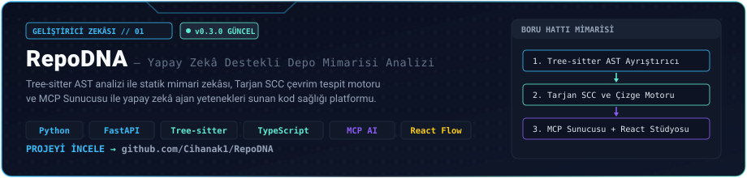
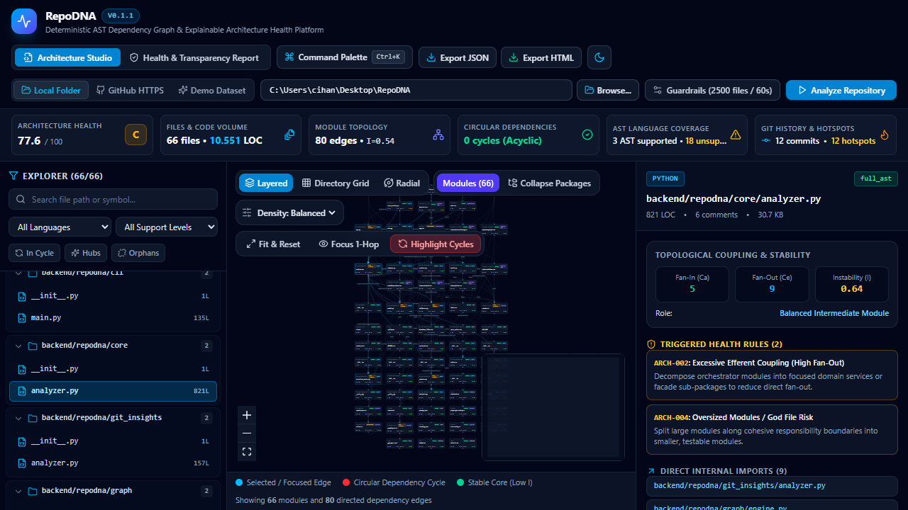
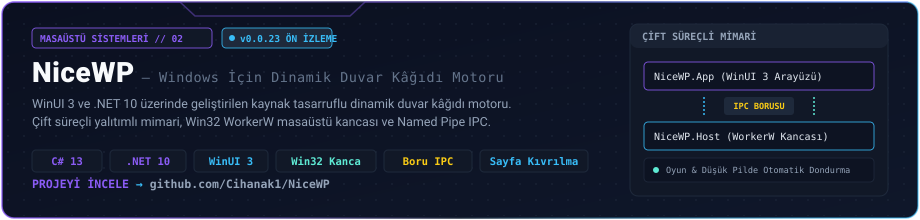
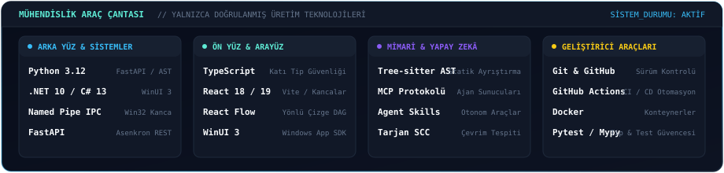

<!-- ================================================================= -->
<!-- CIHAN AKALIN — GELİŞTİRİCİ İŞ İSTASYONU // TÜRKÇE PROFİL         -->
<!-- Hedef: github.com/Cihanak1                                        -->
<!-- ================================================================= -->

<div align="center">

<p align="center">
  <b>🇹🇷 Türkçe</b> &nbsp;·&nbsp; <a href="README_EN.md"><b>🇬🇧 English</b></a>
</p>

<picture>
  <source media="(prefers-color-scheme: dark)" srcset="assets/header-tr-dark.svg">
  <source media="(prefers-color-scheme: light)" srcset="assets/header-tr-light.svg">
  
</picture>

<br>

[](https://www.linkedin.com/in/cihan-akalin/)
[](https://github.com/Cihanak1)
[](https://www.firat.edu.tr)
[](https://github.com/Cihanak1/RepoDNA)

</div>

---

### 👨‍💻 Hakkımda

**Fırat Üniversitesi** Yazılım Mühendisliği **2. sınıf öğrencisiyim**. Mühendislik çalışmalarımı geliştirici araç zincirleri üzerinde yoğunlaştırıyorum: **statik kod analizi, AST tabanlı mimari zekâsı, Model Context Protocol (MCP) entegrasyonları** ve **kaynak tasarruflu Windows sistem mühendisliği**.

> *"Geliştiricileri daha üretken kılan araçlar inşa ediyorum."*

İster **RepoDNA** projesinde çok dilli kod tabanlarından yönlü çevrimsiz çizgeler (DAG) çıkararak mimari sağlığı ve döngüsel bağımlılıkları analiz etmek olsun, ister **NiceWP** projesinde Win32 kancalarıyla donanım hızlandırmalı masaüstü çizim motoru geliştirmek olsun; deterministik, mimari açıdan sağlam ve sistem kaynaklarına saygılı yazılımlar üretmeye odaklanıyorum.

---

### 🚀 Öne Çıkan Projelerim

<table>
  <tr>
    <td width="100%">
      <a href="https://github.com/Cihanak1/RepoDNA">
        <picture>
          <source media="(prefers-color-scheme: dark)" srcset="assets/project-repodna-tr-dark.svg">
          <source media="(prefers-color-scheme: light)" srcset="assets/project-repodna-tr-light.svg">
          
        </picture>
      </a>
    </td>
  </tr>
</table>

<details open>
<summary><b>🔍 RepoDNA Stüdyo Arayüzü &amp; Derin Mimari Yetenekleri</b></summary>
<br>

<div align="center">
  <a href="https://github.com/Cihanak1/RepoDNA">
    
  </a>
</div>

- **Tree-sitter AST Ayrıştırma**: Programlama dilleri genelinde yüksek doğruluklu anlamsal sözdizimi ağacı çıkarımı.
- **Tarjan SCC Çevrim Tespiti**: Kod tabanındaki döngüsel bağımlılıkları ve mimari anti-pattern'leri matematiksel kesinlikle ortaya çıkarır.
- **Yapay Zekâ Yerel MCP Sunucusu &amp; Agent Skills**: Kod tabanının topolojik mimari bağlamını token israfı yapmadan doğrudan yapay zekâ ajanlarına (Claude, ChatGPT, Antigravity) sunar.
- **Architecture Diff**: Git dalları arasındaki mimari sapmaları ve etki yarıçapını (blast radius) birleştirmeden önce analiz eder.
- **Canlı Geliştirici Stüdyosu**: React Flow ve FastAPI ile interaktif yönlü çizge (DAG) topoloji görselleştiricisi.

👉 **Repository**: [github.com/Cihanak1/RepoDNA](https://github.com/Cihanak1/RepoDNA) &nbsp;•&nbsp; **Güncel Sürüm**: `v0.3.0`
</details>

<br>

<table>
  <tr>
    <td width="100%">
      <a href="https://github.com/Cihanak1/NiceWP">
        <picture>
          <source media="(prefers-color-scheme: dark)" srcset="assets/project-nicewp-tr-dark.svg">
          <source media="(prefers-color-scheme: light)" srcset="assets/project-nicewp-tr-light.svg">
          
        </picture>
      </a>
    </td>
  </tr>
</table>

<details open>
<summary><b>⚙️ NiceWP Sistem Mimarisi &amp; Performans Modeli</b></summary>
<br>

- **Çift Süreçli Yalıtım**: WinUI 3 yönetim arayüzü (`NiceWP.App`) ile Win32 arka plan çizim motoru (`NiceWP.Runtime.Host`) arasında tam mimari ayrım.
- **Düşük Seviyeli Masaüstü Kancası**: Windows kabuk stabilitesini ve masaüstü simgelerini etkilemeden Win32 `WorkerW` aracılığıyla çizim yapar.
- **Named Pipe IPC**: Süreç sınırları arasında yüksek verimlilikli yerel ikili mesajlaşma boru hattı.
- **60 FPS Sayfa Kıvrılma (Page Turn)**: Duvar kâğıdını kalıcı uygulamadan önce ekranın köşesinden canlı önizleme sağlayan akıcı sürükleme efekti.
- **Adaptif Sistem Zekâsı**: Tam ekran oyunlar, video oynatımı ve pil tasarrufu devreye girdiğinde video çizim döngüsünü otomatik dondurarak sıfır işlemci/ekran kartı yükü bırakır.

👉 **Repository**: [github.com/Cihanak1/NiceWP](https://github.com/Cihanak1/NiceWP) &nbsp;•&nbsp; **Güncel Sürüm**: `v0.0.23 Ön İzleme`
</details>

---

### 🧰 Teknoloji Araçlarım

<div align="center">
  <picture>
    <source media="(prefers-color-scheme: dark)" srcset="assets/toolbox-tr-dark.svg">
    <source media="(prefers-color-scheme: light)" srcset="assets/toolbox-tr-light.svg">
    
  </picture>
</div>

---

### 👾 Katkı Macerası — Pac-Man

<div align="center">
  <picture>
    <source media="(prefers-color-scheme: dark)" srcset="https://raw.githubusercontent.com/Cihanak1/Cihanak1/output/pacman-contribution-graph-dark.svg">
    <source media="(prefers-color-scheme: light)" srcset="https://raw.githubusercontent.com/Cihanak1/Cihanak1/output/pacman-contribution-graph.svg">
    
  </picture>
</div>

<p align="center">
  <sub>🕹️ <a href="https://github.com/abozanona/pacman-contribution-graph">pacman-contribution-graph</a> motoru ile üretilmiştir &nbsp;•&nbsp; GitHub Actions ile her gece otomatik yenilenir &nbsp;•&nbsp; Açık / Koyu tema uyumlu</sub>
</p>

---

### 📊 Yazılım Geliştirme Aktivitem

GitHub GraphQL API üzerinden toplanan 52 haftalık gerçek zamanlı aktivite darbeleri ve telemetri verileri. Haftalık geliştirme ritmimi ve commit yoğunluğumu yansıtır.

<div align="center">
  <picture>
    <source media="(prefers-color-scheme: dark)" srcset="assets/activity-monitor-tr-dark.svg">
    <source media="(prefers-color-scheme: light)" srcset="assets/activity-monitor-tr-light.svg">
    
  </picture>
</div>

---

### 📂 Açık Kaynak Projelerim

| Proje | Alan | Temel Teknolojiler | Durum |
| :--- | :--- | :--- | :--- |
| [**RepoDNA**](https://github.com/Cihanak1/RepoDNA) | Yapay Zekâ Destekli Depo Mimarisi Analizi | Python, Tree-sitter, FastAPI, React Flow, MCP | `v0.3.0 Güncel` |
| [**NiceWP**](https://github.com/Cihanak1/NiceWP) | Windows Masaüstü Sistem Mühendisliği | C# 13, .NET 10, WinUI 3, Win32 WorkerW, IPC | `v0.0.23 Ön İzleme` |
| [**chatgpt-mcp-bridge**](https://github.com/Cihanak1/chatgpt-mcp-bridge) | Yapay Zekâ Ajan Altyapısı | JavaScript, Node.js, MCP Protocol | `Aktif` |
| [**LectaPdf**](https://github.com/Cihanak1/LectaPdf) | Belge Mühendisliği & Ayrıştırma | TypeScript, PDF Parsing | `Aktif` |
| [**TeleBot**](https://github.com/Cihanak1/TeleBot) | Otomasyon ve Bot Sistemleri | Python, AsyncIO | `Aktif` |

---

### 📬 İletişim

<div align="center">

```
========================================================================
CIHAN AKALIN // YAZILIM MÜHENDİSLİĞİ // FIRAT ÜNİVERSİTESİ
Geliştirici Araçları ve Sistem Mimarisi Çalışmaları
========================================================================
```

[](https://www.linkedin.com/in/cihan-akalin/)
[](https://github.com/Cihanak1)

</div>
