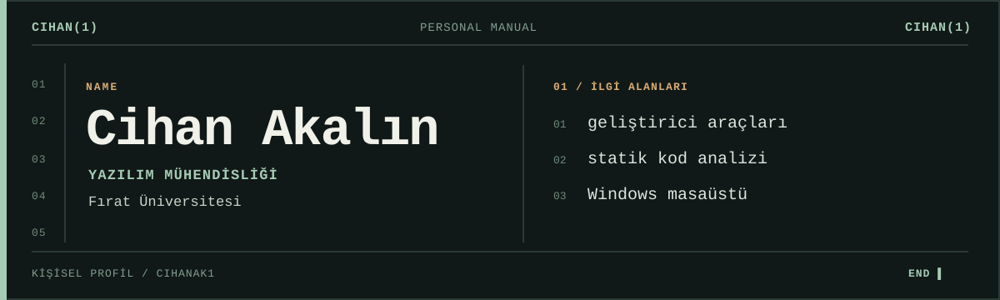

<strong>TR</strong> &nbsp;/&nbsp; <a href="README_EN.md">EN</a>

## Hakkımda

Ben Cihan. Fırat Üniversitesi'nde yazılım mühendisliği okuyorum. Kodun nasıl örgütlendiği ve yazılımın işletim sistemiyle buluştuğu yer ilgimi çekiyor.

Bir kod tabanındaki ilişkileri görünür kılmak, değişikliklerin etkisini anlamak ve masaüstünde kaynak kullanımını gözeten yazılımlar geliştirmek üzerine çalışıyorum. Öğrenirken denediğim şeyleri açık depolarımda paylaşıyorum.

## İlgi alanlarım

| Alan | İlgimi çeken soru |
| :--- | :--- |
| Statik analiz | Kodu çalıştırmadan yapısı hakkında ne öğrenebiliriz? |
| Geliştirici araçları | Karmaşık bir depoyu nasıl daha anlaşılır kılarız? |
| Windows masaüstü | Akıcı bir deneyim sunarken sistem kaynaklarını nasıl koruruz? |

## Bağlantılar

[Depolarım](https://github.com/Cihanak1?tab=repositories) &nbsp;·&nbsp; [LinkedIn](https://www.linkedin.com/in/cihan-akalin/)
