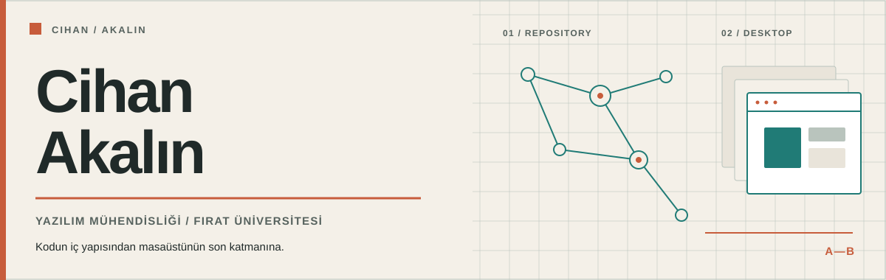
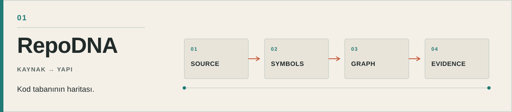
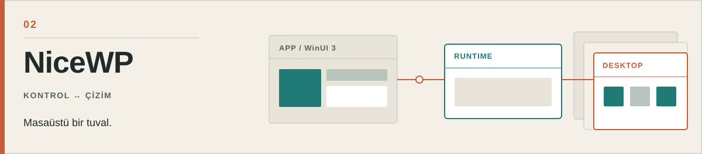

  <strong>Türkçe</strong> &nbsp;·&nbsp; <a href="README_EN.md">English</a>

<picture>
  <source media="(prefers-color-scheme: dark)" srcset="visuals/masthead-tr-dark.svg">
  <source media="(prefers-color-scheme: light)" srcset="visuals/masthead-tr-light.svg">
  
</picture>

## Merhaba, ben Cihan.

Fırat Üniversitesi'nde yazılım mühendisliği okuyorum. Bir kod tabanının içindeki ilişkileri görünür kılan araçlar ve Windows masaüstü için uygulamalar geliştiriyorum. İki alanda da ilgimi çeken şey aynı: karmaşık bir sistemi anlaşılır, denetlenebilir ve kullanışlı hâle getirmek.

## Seçili işler

### 01 / RepoDNA — kod tabanının haritası

<a href="https://github.com/Cihanak1/RepoDNA">
  <picture>
    <source media="(prefers-color-scheme: dark)" srcset="visuals/repodna-tr-dark.svg">
    <source media="(prefers-color-scheme: light)" srcset="visuals/repodna-tr-light.svg">
    
  </picture>
</a>

Bir depoda “bu değişiklik nereleri etkiler?” sorusunun peşinden gidiyor. Tree-sitter ile sembolleri ve modüller arasındaki ilişkileri çıkarıyor; bağımlılık döngülerini, mimari sınırları ve değişiklik etkisini incelemek için komut satırı, görsel arayüz ve MCP sunucusu sunuyor.

**Kullandığım araçlar:** Python, TypeScript, Tree-sitter, FastAPI. 
**İncele:** [Kaynak kod ve dokümantasyon](https://github.com/Cihanak1/RepoDNA)

### 02 / NiceWP — masaüstünün katmanları

<a href="https://github.com/Cihanak1/NiceWP">
  <picture>
    <source media="(prefers-color-scheme: dark)" srcset="visuals/nicewp-tr-dark.svg">
    <source media="(prefers-color-scheme: light)" srcset="visuals/nicewp-tr-light.svg">
    
  </picture>
</a>

Windows için statik ve video duvar kâğıtlarıyla çalışan bir uygulama. WinUI 3 arayüzünü masaüstü çizim motorundan ayrı bir süreçte tutuyor. Tam ekran uygulamalar ve pil tasarrufu gibi durumlarda video oynatımını duraklatacak şekilde tasarlandı.

**Kullandığım araçlar:** C#, .NET, WinUI 3, Win32. 
**İncele:** [Kaynak kod ve sürüm bilgileri](https://github.com/Cihanak1/NiceWP)

---

Diğer çalışmalarım [depolar sayfamda](https://github.com/Cihanak1?tab=repositories). Bir projeye dair fikir veya geri bildirim paylaşmak istersen [LinkedIn'den ulaşabilirsin](https://www.linkedin.com/in/cihan-akalin/).
