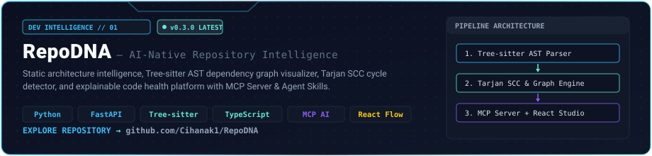
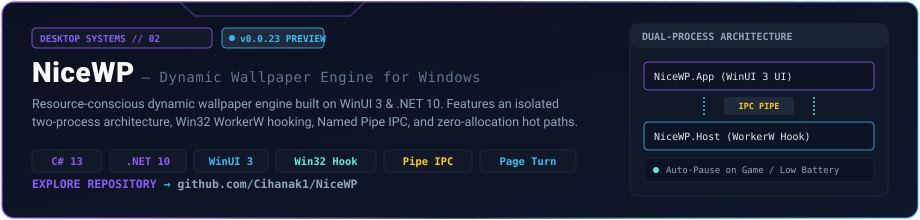
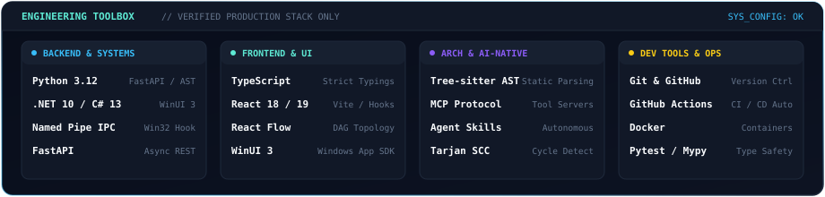

<!-- ================================================================= -->
<!-- CIHAN AKALIN — ENGINEERING WORKSTATION // ENGLISH PROFILE         -->
<!-- Target: github.com/Cihanak1                                        -->
<!-- ================================================================= -->

<div align="center">

<p align="center">
  <a href="README.md"><b>🇹🇷 Türkçe</b></a> &nbsp;·&nbsp; <b>🇬🇧 English</b>
</p>

<picture>
  <source media="(prefers-color-scheme: dark)" srcset="assets/hero-en-dark.svg">
  <source media="(prefers-color-scheme: light)" srcset="assets/hero-en-light.svg">
  
</picture>

<br>

[](https://www.linkedin.com/in/cihan-akalin/)
[](https://github.com/Cihanak1)
[](https://www.firat.edu.tr)
[](https://github.com/Cihanak1/RepoDNA)

</div>

---

### 👨‍💻 About Me

I am a **second-year Software Engineering student** at **Fırat University**, Türkiye. My engineering work is concentrated on the developer toolchain: **static code analysis, AST-based architecture intelligence, Model Context Protocol (MCP) integrations**, and **resource-conscious Windows systems engineering**.

> *"Building tools that make developers more effective."*

Whether extracting directed acyclic graphs from multi-language repositories in **RepoDNA** or driving hardware-accelerated desktop composition via isolated Win32 hooks in **NiceWP**, I focus on building software that is deterministic, architecturally sound, and respectful of system resources.

---

### 🚀 Featured Engineering Projects

<table>
  <tr>
    <td width="100%">
      <a href="https://github.com/Cihanak1/RepoDNA">
        <picture>
          <source media="(prefers-color-scheme: dark)" srcset="assets/project-repodna-en-dark.svg">
          <source media="(prefers-color-scheme: light)" srcset="assets/project-repodna-en-light.svg">
          
        </picture>
      </a>
    </td>
  </tr>
</table>

<details open>
<summary><b>🔍 RepoDNA Workstation Interface &amp; Deep Architectural Capabilities</b></summary>
<br>

<div align="center">
  <a href="https://github.com/Cihanak1/RepoDNA">
    
  </a>
</div>

- **Tree-sitter AST Parsing**: High-fidelity semantic source extraction across languages.
- **Tarjan SCC Cycle Detection**: Discovers circular dependencies and structural anti-patterns with mathematical proof.
- **AI-Native MCP Server &amp; Agent Skills**: Exposes repository topological context directly to LLM agents (Claude, ChatGPT, Antigravity) without token pollution.
- **Architecture Diff**: Compares architecture graphs between git branches to detect drift before merges.
- **Live Workstation**: Interactive DAG topology visualizer powered by React Flow and FastAPI.

👉 **Repository**: [github.com/Cihanak1/RepoDNA](https://github.com/Cihanak1/RepoDNA) &nbsp;•&nbsp; **Latest Release**: `v0.3.0`
</details>

<br>

<table>
  <tr>
    <td width="100%">
      <a href="https://github.com/Cihanak1/NiceWP">
        <picture>
          <source media="(prefers-color-scheme: dark)" srcset="assets/project-nicewp-en-dark.svg">
          <source media="(prefers-color-scheme: light)" srcset="assets/project-nicewp-en-light.svg">
          
        </picture>
      </a>
    </td>
  </tr>
</table>

<details open>
<summary><b>⚙️ NiceWP Systems Architecture &amp; Performance Model</b></summary>
<br>

- **Dual-Process Isolation**: Strict architectural separation between the WinUI 3 management frontend (`NiceWP.App`) and the Win32 background renderer (`NiceWP.Runtime.Host`).
- **Low-Level Desktop Hooking**: Injects behind desktop icons via Win32 `WorkerW` hooks without altering shell stability.
- **IPC over Named Pipes**: High-performance local messaging protocol between process boundaries.
- **60 FPS Page Turn**: Real-time corner peel interactive effect for instant wallpaper previewing.
- **Adaptive Intelligence**: Deep-freezes rendering hot paths automatically during fullscreen games, video playback, and Windows battery-saver states.

👉 **Repository**: [github.com/Cihanak1/NiceWP](https://github.com/Cihanak1/NiceWP) &nbsp;•&nbsp; **Latest Release**: `v0.0.23 PREVIEW`
</details>

---

### 🧰 Technology Toolbox

<div align="center">
  <picture>
    <source media="(prefers-color-scheme: dark)" srcset="assets/toolbox-en-dark.svg">
    <source media="(prefers-color-scheme: light)" srcset="assets/toolbox-en-light.svg">
    
  </picture>
</div>

---

### 👾 Contribution Arcade — Pac-Man

<div align="center">
  <picture>
    <source media="(prefers-color-scheme: dark)" srcset="https://raw.githubusercontent.com/Cihanak1/Cihanak1/output/pacman-contribution-graph-dark.svg">
    <source media="(prefers-color-scheme: light)" srcset="https://raw.githubusercontent.com/Cihanak1/Cihanak1/output/pacman-contribution-graph.svg">
    
  </picture>
</div>

<p align="center">
  <sub>🕹️ Powered by <a href="https://github.com/abozanona/pacman-contribution-graph">pacman-contribution-graph</a> &nbsp;•&nbsp; Automated daily via GitHub Actions &nbsp;•&nbsp; Dynamic Light / Dark mode</sub>
</p>

---

### 📊 Engineering Activity Monitor

Real-time 52-week activity pulses and telemetry aggregated from GitHub's GraphQL API. Tracks weekly development rhythm and commit cadence.

<div align="center">
  <picture>
    <source media="(prefers-color-scheme: dark)" srcset="assets/activity-monitor-en-dark.svg">
    <source media="(prefers-color-scheme: light)" srcset="assets/activity-monitor-en-light.svg">
    
  </picture>
</div>

---

### 📂 Open Source &amp; Architecture Repositories

| Repository | Discipline | Key Technologies | Status |
| :--- | :--- | :--- | :--- |
| [**RepoDNA**](https://github.com/Cihanak1/RepoDNA) | AI-Native Developer Intelligence | Python, Tree-sitter, FastAPI, React Flow, MCP | `v0.3.0 Latest` |
| [**NiceWP**](https://github.com/Cihanak1/NiceWP) | Windows Desktop Systems | C# 13, .NET 10, WinUI 3, Win32 WorkerW, IPC | `v0.0.23 Preview` |
| [**chatgpt-mcp-bridge**](https://github.com/Cihanak1/chatgpt-mcp-bridge) | AI Agent Infrastructure | JavaScript, Node.js, MCP Protocol | `Active` |
| [**LectaPdf**](https://github.com/Cihanak1/LectaPdf) | Document Engineering | TypeScript, PDF Parsing | `Active` |
| [**TeleBot**](https://github.com/Cihanak1/TeleBot) | Automation &amp; Bots | Python, AsyncIO | `Active` |

---

### 📬 Connect With Me

<div align="center">

```
========================================================================
CIHAN AKALIN // SOFTWARE ENGINEERING // FIRAT UNIVERSITY
Available for: Developer Tools Collaboration & Systems Engineering
========================================================================
```

[](https://www.linkedin.com/in/cihan-akalin/)
[](https://github.com/Cihanak1)

</div>
