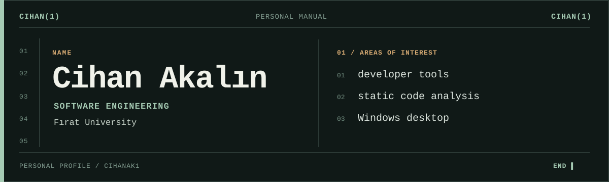

<a href="README.md">TR</a> &nbsp;/&nbsp; <strong>EN</strong>

## About me

I'm Cihan, a software engineering student at Fırat University. I'm interested in how code is organized and in the point where software meets the operating system.

I work on making relationships within codebases visible, understanding the impact of changes, and building desktop software with resource use in mind. I share what I try and learn in my public repositories.

## Areas of interest

| Area | Question I keep returning to |
| :--- | :--- |
| Static analysis | What can we learn about code without running it? |
| Developer tools | How can we make a complex repository easier to understand? |
| Windows desktop | How can an app feel fluid while respecting system resources? |

## Links

[Repositories](https://github.com/Cihanak1?tab=repositories) &nbsp;·&nbsp; [LinkedIn](https://www.linkedin.com/in/cihan-akalin/)
