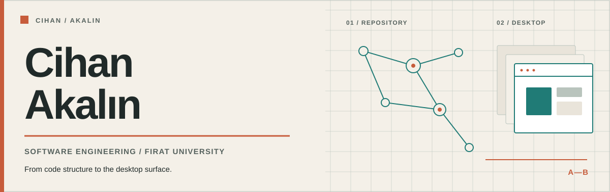
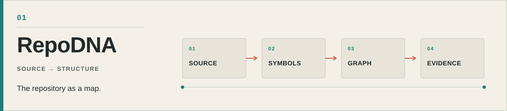
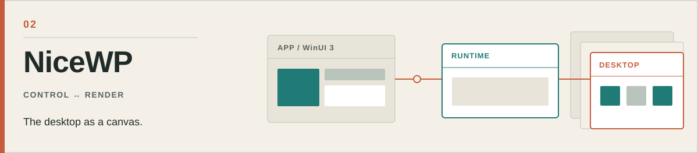

  <a href="README.md">Türkçe</a> &nbsp;·&nbsp; <strong>English</strong>

<picture>
  <source media="(prefers-color-scheme: dark)" srcset="visuals/masthead-en-dark.svg">
  <source media="(prefers-color-scheme: light)" srcset="visuals/masthead-en-light.svg">
  
</picture>

## Hi, I'm Cihan.

I study software engineering at Fırat University. I build tools that reveal the relationships inside a codebase and applications for the Windows desktop. What draws me to both is the same: making a complex system easier to understand, inspect, and use.

## Selected work

### 01 / RepoDNA — a map of the codebase

<a href="https://github.com/Cihanak1/RepoDNA">
  <picture>
    <source media="(prefers-color-scheme: dark)" srcset="visuals/repodna-en-dark.svg">
    <source media="(prefers-color-scheme: light)" srcset="visuals/repodna-en-light.svg">
    
  </picture>
</a>

RepoDNA explores the question “what would this change affect?” in a repository. It uses Tree-sitter to extract symbols and relationships between modules, and provides a CLI, visual interface, and MCP server for examining dependency cycles, architectural boundaries, and change impact.

**Built with:** Python, TypeScript, Tree-sitter, FastAPI. 
**Explore:** [Source and documentation](https://github.com/Cihanak1/RepoDNA)

### 02 / NiceWP — layers of the desktop

<a href="https://github.com/Cihanak1/NiceWP">
  <picture>
    <source media="(prefers-color-scheme: dark)" srcset="visuals/nicewp-en-dark.svg">
    <source media="(prefers-color-scheme: light)" srcset="visuals/nicewp-en-light.svg">
    
  </picture>
</a>

A Windows app for static and video wallpapers. It keeps the WinUI 3 interface in a separate process from the desktop renderer. It is designed to pause video playback when a fullscreen app or battery saver is active.

**Built with:** C#, .NET, WinUI 3, Win32. 
**Explore:** [Source and release information](https://github.com/Cihanak1/NiceWP)

---

You can find the rest of my work in [my repositories](https://github.com/Cihanak1?tab=repositories). For ideas or feedback on a project, [reach me on LinkedIn](https://www.linkedin.com/in/cihan-akalin/).
